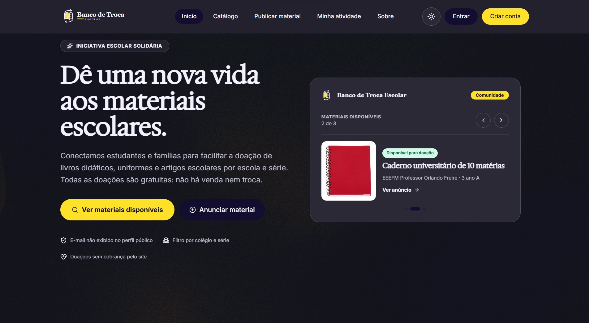
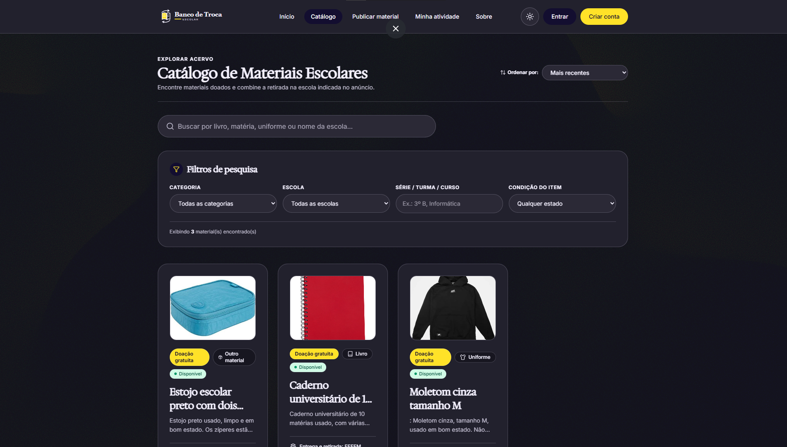
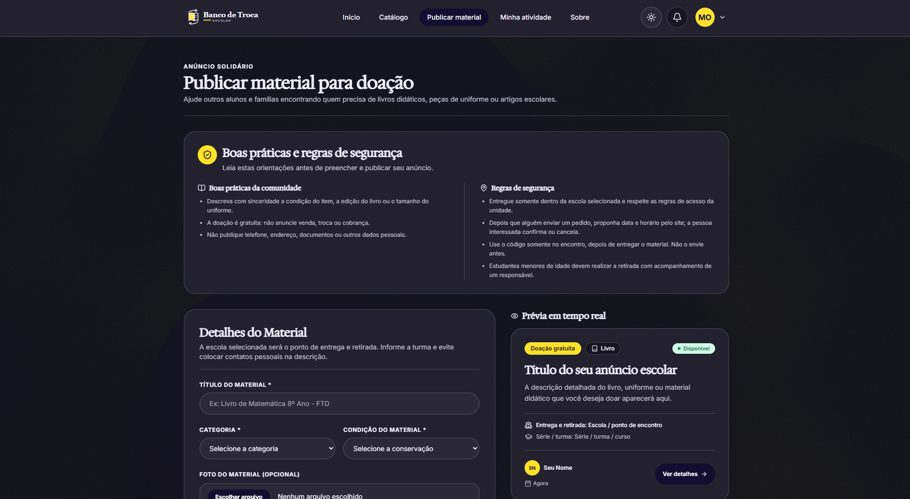
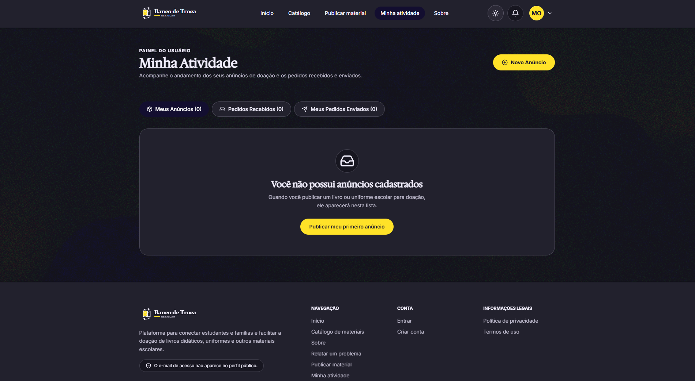
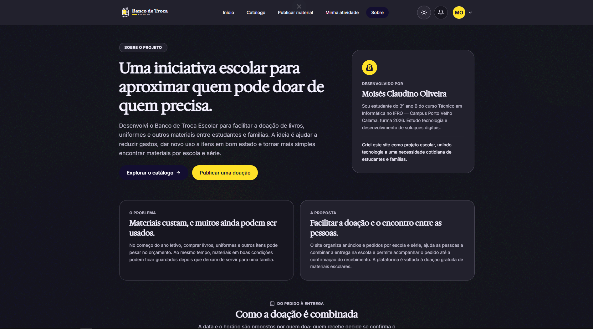

# Banco de Troca Escolar

Aplicação web comunitária para aproximar estudantes, responsáveis e famílias que querem **doar ou receber materiais escolares gratuitamente**. O catálogo organiza anúncios por escola, série, categoria e conservação; o fluxo registra pedidos, combinação de entrega e confirmação do recebimento.

## Prévia das telas

As imagens abaixo mostram as principais áreas da aplicação. Clique em uma imagem para abri-la em tamanho completo.

<table>
  <tr>
    <td align="center" width="50%">
      <a href="public/imagens/tela-inicial.png"></a><br>
      <strong>Início</strong>
    </td>
    <td align="center" width="50%">
      <a href="public/imagens/tela-catalogo.png"></a><br>
      <strong>Catálogo</strong>
    </td>
  </tr>
  <tr>
    <td align="center" width="50%">
      <a href="public/imagens/publicar-material.png"></a><br>
      <strong>Publicar material</strong>
    </td>
    <td align="center" width="50%">
      <a href="public/imagens/minha-atividade.png"></a><br>
      <strong>Minha atividade</strong>
    </td>
  </tr>
  <tr>
    <td align="center" width="50%">
      <a href="public/imagens/tela-sobre.png"></a><br>
      <strong>Sobre o projeto</strong>
    </td>
    <td width="50%"></td>
  </tr>
</table>

> Apesar do nome, o sistema atual não faz trocas comerciais: não vende, compra, cobra nem processa pagamentos. A entrega é combinada entre as pessoas, na escola indicada no anúncio.

## O que o sistema oferece

- **Página inicial:** apresenta a proposta, mostra um carrossel de anúncios recentes, indicadores de materiais disponíveis e doações concluídas e explica as etapas da doação.
- **Catálogo:** busca anúncios por texto, escola, série, categoria e conservação; permite ordenar por mais recentes ou alfabeticamente.
- **Anúncios:** exibe descrição, categoria, conservação, escola, série e foto opcional. Uma pessoa autenticada pode denunciar um anúncio por cobrança indevida, exposição de dados pessoais, conteúdo impróprio ou informação incorreta.
- **Contas:** cadastro com e-mail e senha, confirmação de e-mail, login, encerramento de sessão e redefinição de senha por link.
- **Publicação:** contas autenticadas publicam livros, uniformes ou outros materiais, com título, descrição, escola de referência, série, condição e foto opcional. As orientações de segurança ficam junto ao formulário.
- **Pedidos de interesse:** uma pessoa autenticada pode enviar uma mensagem sobre um anúncio. A pessoa doadora recebe o pedido e pode propor data, horário e uma mensagem para a entrega.
- **Reserva e entrega:** ao propor o encontro, o anúncio fica reservado. Quem solicitou confirma a data ou cancela; ao cancelar, a reserva termina e o anúncio pode voltar ao catálogo. No encontro, a confirmação é feita com um código do pedido.
- **Minha Atividade:** reúne anúncios próprios, pedidos recebidos e enviados, estados da reserva e ações disponíveis para cada etapa. Também permite pausar, reativar ou excluir anúncios próprios e marcar uma doação como concluída.
- **Notificações:** informam eventos dos pedidos e permitem marcar avisos como lidos. A tabela e os gatilhos correspondentes precisam estar configurados no Supabase.
- **Perfis:** edição de nome de exibição, escola e foto; página pública com os dados escolhidos para exibição e indicadores de doações.
- **Relatos e privacidade:** formulário para problemas técnicos, erros de conteúdo, acessibilidade, sugestões e solicitações de dados pessoais. Solicitações de privacidade são analisadas manualmente; o formulário não apaga dados automaticamente.
- **Administração:** painel restrito a administradores com métricas, moderação de relatos e denúncias, retirada de anúncios e convites de uso único para outros administradores. Convites expiram em sete dias e só podem ser aceitos pela conta de e-mail confirmada correspondente.
- **Páginas informativas:** Sobre, Política de Privacidade e Termos de Uso.
- **Interface:** tema claro/escuro, layout responsivo, fundo animado, entradas suaves ao rolar, microinterações nos cards e respeito à preferência de movimento reduzido do dispositivo; também oferece foco de teclado e link para pular ao conteúdo principal.

## Contexto e diferencial

O projeto foi pensado para complementar formas de doação que já existem. Em 2024, a Prefeitura de Porto Velho publicou uma campanha de arrecadação de materiais escolares com pontos físicos de coleta; a Biblioteca Municipal Francisco Meirelles recebe livros conforme critérios de conservação e acervo; e classificados gerais, como a OLX, atendem muitas categorias e permitem anunciar doações ou trocas. Essas iniciativas têm seus próprios objetivos e regras — o Banco de Troca Escolar não as substitui nem afirma ter parceria com elas.

O diferencial implementado é concentrar anúncios **somente de materiais escolares**, com campos e filtros estruturados para escola, série, categoria e conservação. A lista de escolas disponível no formulário é voltada a Porto Velho. A busca não possui filtro por bairro, mapa nem localização residencial. Depois de solicitar um item, as contas acompanham a proposta de data e horário, a confirmação ou o cancelamento e o registro da entrega por código.

Referências públicas usadas como contexto: [campanha da Prefeitura de Porto Velho (2024)](https://www.portovelho.ro.gov.br/artigo/45345/), [critérios de doação da Biblioteca Municipal Francisco Meirelles](https://sites.google.com/view/bibliotecafranciscomeirelles/servi%C3%A7os/doa%C3%A7%C3%B5es) e [orientações gerais para publicar na OLX](https://ajuda.olx.com.br/s/article/como-publicar-anuncio).

## Tecnologias

| Tecnologia | Uso |
| --- | --- |
| Next.js 15 (App Router) | Páginas, rotas e execução da aplicação web |
| React 19 | Interface e componentes interativos |
| TypeScript | Tipos e validação estática do código |
| Tailwind CSS 4 | Estilos e adaptação a telas diferentes |
| Supabase Auth | Cadastro, confirmação de e-mail, sessão e redefinição de senha |
| Supabase Postgres | Anúncios, perfis, pedidos, relatos e regras de acesso RLS |
| Supabase Storage | Fotos de materiais e perfis |
| Three.js, React Three Fiber e ShaderGradient | Fundo animado |
| Lucide React | Ícones |
| Vercel | Hospedagem de produção e integração de deploy com Git |

## Requisitos

- Node.js LTS compatível com Next.js 15 e npm.
- Uma conta e um projeto Supabase próprios para autenticação, banco e arquivos.
- As credenciais públicas do projeto Supabase: URL e chave `publishable` (em projetos antigos, pode aparecer como `anon key`).

## Executar localmente

```bash
git clone https://github.com/Moises-Olv/banco-de-troca-escolar.git
cd banco-de-troca-escolar
npm install
```

Crie `.env.local` na raiz (não envie esse arquivo ao Git):

```dotenv
NEXT_PUBLIC_SUPABASE_URL=https://SEU-PROJETO.supabase.co
NEXT_PUBLIC_SUPABASE_PUBLISHABLE_KEY=sua_chave_publishable
```

No painel Supabase, configure a autenticação e as URLs de retorno para o ambiente local e para o domínio da sua implantação. A rota de callback usada pela aplicação é `/auth/callback`. Configure também os modelos e o envio de e-mail de confirmação e redefinição de senha.

Depois, inicie o servidor de desenvolvimento:

```bash
npm run dev
```

Abra [http://localhost:3000](http://localhost:3000). Para gerar e executar a versão de produção localmente:

```bash
npm run build
npm run start
```

## Configurar seu próprio Supabase

O código cliente necessita apenas da URL e da chave `publishable`. **Nunca** coloque uma `service_role`, chave secreta, senha de banco ou token em variável `NEXT_PUBLIC_*`, no código do navegador ou em commits. A chave publishable não substitui as políticas RLS.

Os scripts em [`supabase/`](supabase/) são migrações complementares do banco e foram escritos para a estrutura usada pela aplicação. Podem ser executados no **Supabase Dashboard → SQL Editor**, em projeto de desenvolvimento próprio. Leia cada arquivo antes de executar e use esta sequência para uma instalação que ainda não tenha as tabelas auxiliares:

1. Prepare primeiro as tabelas base `public.materiais` e `auth.users` compatíveis com os campos consultados pela aplicação. **O repositório atual não contém uma migração inicial completa para `public.materiais`**; `atividade.sql` cria `pedidos_interesse`, mas depende da tabela de materiais preexistente. Portanto, um clone limpo ainda precisa obter/criar esse esquema base antes de seguir. Não execute scripts contra uma base de produção sem backup e revisão.
2. Execute `supabase/perfis-publicos.sql` para perfis, fotos de perfil e estatísticas públicas.
3. Execute `supabase/atividade.sql` para pedidos, índices e regras de acesso aos anúncios e pedidos.
4. Execute `supabase/apenas-doacao.sql` para manter a modalidade do sistema como doação.
5. Execute `supabase/fluxo-pedidos-reserva.sql` e, em seguida, `supabase/fluxo-data-entrega.sql` para reserva, proposta/aceitação da data, cancelamento e confirmação com código.
6. Execute `supabase/fotos-materiais.sql` para o bucket e as políticas de fotos dos materiais.
7. Execute `supabase/relatos-erros.sql` e depois `supabase/privacidade-lgpd.sql` para relatos e solicitações de privacidade.
8. Execute `supabase/administracao.sql` para administração, convites, denúncias e moderação. **Antes**, edite `v_email_admin` no bloco de bootstrap e substitua `SUBSTITUA_PELO_EMAIL_CONFIRMADO_DO_ADMIN` pelo e-mail confirmado da sua própria conta. O script interrompe a execução enquanto o marcador não for alterado. Nunca publique dados pessoais de outra pessoa ao adaptar o arquivo.
9. Execute `supabase/notificacoes.sql` para notificações de pedidos.
10. Execute `supabase/moderacao-anuncios.sql` e `supabase/seguranca-acesso-funcoes.sql` para as regras complementares de moderação e permissões das funções.
11. Execute `supabase/indices-desempenho.sql` por último para índices e a view otimizada do catálogo.

Alguns scripts podem ser aplicados em bases existentes e podem conter transformações de dados. Leia o SQL e confirme os pré-requisitos do próprio arquivo antes de rodar. O resultado não é uma migração universal de um clique. As verificações de segurança dependem de RLS e das funções do banco; esconder botões na interface não é controle de acesso.

### Storage

O projeto usa buckets públicos para leitura de fotos, com upload e remoção limitados à pasta do usuário autenticado pelas políticas de Storage. Os scripts aceitam JPEG, PNG e WebP, com limite de 5 MB. Não envie imagens com rostos de menores, documentos, contatos ou outras informações pessoais.

### Deploy próprio na Vercel

1. Publique o repositório na sua conta/organização GitHub e importe-o na Vercel.
2. Selecione Next.js e a raiz do projeto (`./`). Os comandos padrão são `npm run build` e `npm run start`.
3. Cadastre na Vercel as mesmas variáveis públicas `NEXT_PUBLIC_SUPABASE_URL` e `NEXT_PUBLIC_SUPABASE_PUBLISHABLE_KEY` para os ambientes desejados.
4. No Supabase, adicione o domínio Vercel às URLs autorizadas de autenticação e configure a URL de callback `https://SEU-DOMINIO/auth/callback`.
5. Faça o deploy e teste cadastro, confirmação de e-mail, login, catálogo, publicação, pedido e fluxo de entrega no seu próprio projeto.

Não copie as credenciais Supabase de outra instalação. Cada instância deve usar o próprio projeto Supabase e sua própria configuração de administrador.

## Rotas principais

| Rota | Acesso | Função |
| --- | --- | --- |
| `/` | Público | Apresentação, carrossel, indicadores e passos |
| `/catalogo` | Público | Busca e filtros de anúncios disponíveis |
| `/materiais/[id]` | Público; ações exigem login | Detalhes e pedido/denúncia |
| `/cadastro` | Público | Criação de conta |
| `/entrar` | Público | Login |
| `/redefinir-senha` | Público, a partir do link recebido | Redefinição de senha |
| `/auth/callback` | Fluxo de autenticação | Recebe confirmação e retorno do Supabase |
| `/publicar` | Conta autenticada | Publicação de doação |
| `/minha-atividade` | Conta autenticada | Anúncios e pedidos da conta |
| `/perfil` | Conta autenticada | Edição do próprio perfil |
| `/perfil/[id]` | Público | Perfil público |
| `/sobre` | Público | Contexto, fluxo e formulário de relatos/privacidade |
| `/privacidade` | Público | Política de privacidade |
| `/termos` | Público | Termos de uso |
| `/admin` | Administrador | Métricas, moderação e convites administrativos |
| `/admin/aceitar` | Conta autenticada com convite | Aceite de convite administrativo |

## Estrutura do repositório

```text
app/          rotas e páginas Next.js
components/   componentes reutilizáveis da interface
data/         tipos e opções apresentadas nos formulários
lib/          integração Supabase e funções compartilhadas
public/       imagens, logos, ícones e outros arquivos públicos
supabase/     scripts SQL complementares do banco
docs/         especificação, referência inicial e organização de assets
```

A especificação detalhada do comportamento atual está em [`docs/spec-moises-2.md`](docs/spec-moises-2.md). [`docs/spec-inicial.md`](docs/spec-inicial.md) é a proposta antiga, mantida como referência histórica; ela não descreve o sistema atual. A organização dos arquivos em `public/` está documentada em [`docs/assets-publicos.md`](docs/assets-publicos.md).

## Privacidade, segurança e limites

- O acesso a anúncios, pedidos, perfis, relatos e funções administrativas é limitado por políticas RLS e funções no Postgres; permissões devem ser revistas no Supabase de cada implantação.
- Dados de autenticação ficam no Supabase Auth. A aplicação não deve expor senhas, códigos de confirmação, chaves privadas ou dados não necessários do perfil.
- O formulário do anúncio não tem campos próprios para telefone, e-mail ou endereço residencial, mas descrição e fotos são públicas e podem conter dados inseridos pela pessoa. O nome de exibição e a mensagem da solicitação são mostrados à pessoa doadora na área autenticada Minha Atividade; portanto, os pedidos não são anônimos entre as contas participantes. Não inclua dados de contato em anúncios ou mensagens.
- Os filtros são por escola, série, categoria e conservação. A lista atual de escolas é voltada a Porto Velho; não há filtro por bairro ou mapa.
- Fotos públicas podem ser vistas por visitantes enquanto disponíveis. O upload e a remoção são limitados pela pasta do usuário.
- O site organiza anúncios e pedidos, mas não inspeciona fisicamente materiais nem garante que a pessoa compareça ao encontro.
- A política publicada no site não substitui a revisão dos contratos com fornecedores nem uma análise jurídica da operação.
- Não há checkout, pagamentos, avaliações de usuários ou analytics encontrados no código atual.

## Estado e contribuições

O projeto usa npm e mantém `package-lock.json`. Para propor mudanças, crie uma branch, faça alterações pequenas e descreva como foram verificadas. Não envie `.env.local`, credenciais, dados de usuários ou fotos pessoais.

## Licença

Não há um arquivo `LICENSE` neste repositório neste momento. Tornar o repositório público no GitHub, por si só, não concede uma licença de reutilização. Antes de reutilizar, modificar ou redistribuir o código, consulte o responsável ou aguarde a inclusão de uma licença escolhida pelo titular.
